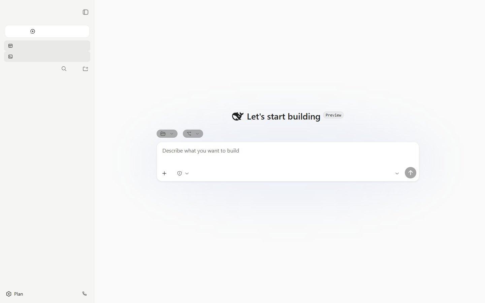
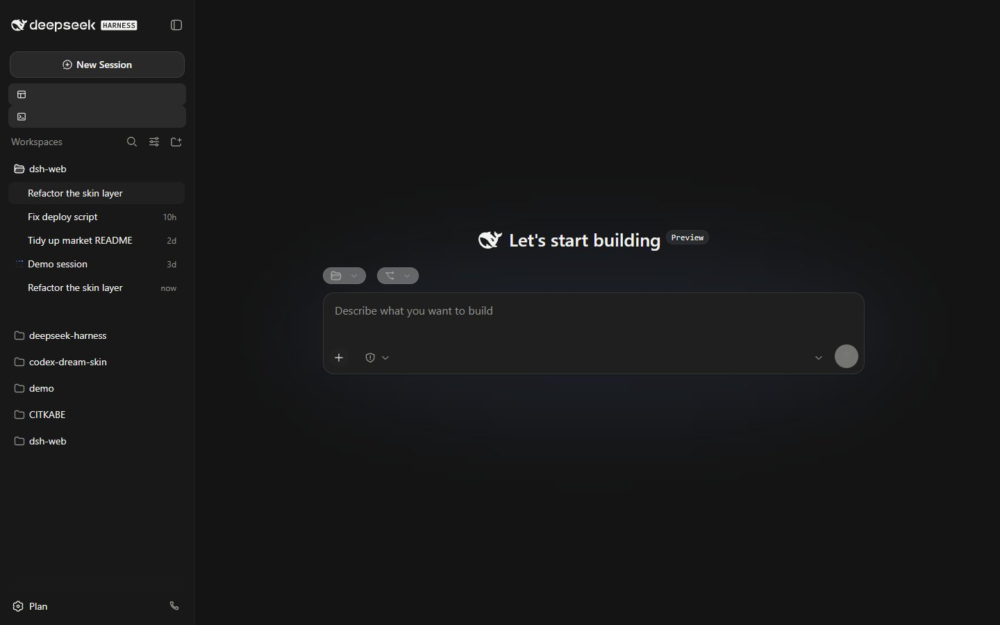

# Frost for DeepSeek Harness

English | [中文](README.md)

A quiet, refined white theme for DSH: a frost-white canvas, graphite primary actions, near-black text, and a complete dark counterpart. Frost is a pure Skin Center v2 asset skin with no JavaScript, artwork, remote fonts, or build step.

| Light | Dark |
| --- | --- |
|  |  |

## Design

- **Layered whites:** #FAFAFA canvas, #FFFFFF content, and two restrained recessed grays.
- **Graphite for action:** #1F1F1F primary controls and active states; chromatic color remains semantic.
- **Quiet details:** neutral hairlines, soft elevation, consistent radii, visible focus, and themed selection and scrollbars.
- **A real dark mode:** cool graphite surfaces and an inverted near-white primary action.

## Install

Requirements: DeepSeek Harness and the community **Skin Center** plugin.

Copy the entire `skins/frost/` directory as a **real directory** to:

```text
~/.dsh/skins/frost/
```

On Windows this is normally `C:\Users\<you>\.dsh\skins\frost\`. Reload DSH, then select **Frost** in **Settings → Skins**.

Do not use a symlink or junction: Skin Center only enumerates real directories.

### Develop locally

```powershell
# Sync changes without changing the active skin
powershell -ExecutionPolicy Bypass -File scripts/sync.ps1

# Sync and activate Frost
powershell -ExecutionPolicy Bypass -File scripts/sync.ps1 -Use

# Validate against the local community v2 tooling
powershell -ExecutionPolicy Bypass -File scripts/validate.ps1
```

Run `scripts/setup.ps1` once if the local validation tooling is absent. The gitignored `.tooling/` directory contains tooling from the community [dsh-skins](https://github.com/zhu1090093659/dsh-skins) repository; it is not a built-in official DSH CLI.

## Publish

The repository can be published on GitHub for manual installation. For distribution through DSH Market, submit the skin to the community [dsh-skins](https://github.com/zhu1090093659/dsh-skins) repository. Include real light and dark screenshots, bilingual documentation, license information, and the screenshot evidence required by its [contribution guide](https://github.com/zhu1090093659/dsh-skins/blob/main/CONTRIBUTING.md). The PR template and byte-identical evidence requirements are recorded in the [publishing guide](docs/publishing.md).

## License

[MIT](LICENSE) © 2026 NanBei.W. All styles and copy are original. No third-party artwork, fonts, or character assets are included.
