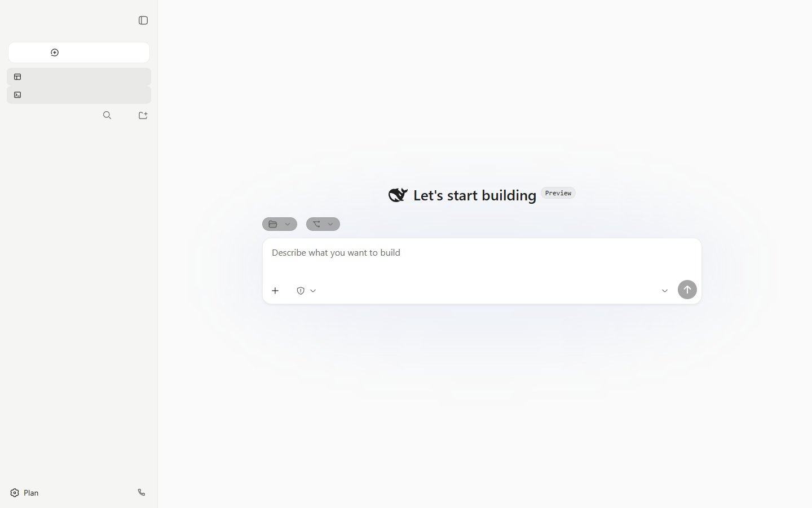
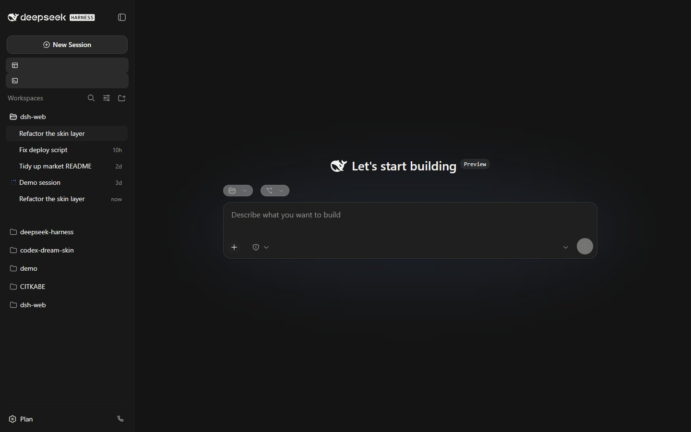

# Frost for DeepSeek Harness

[English](README.en.md) | 中文

一套安静、精致的白色 DSH 主题：霜白画布、石墨黑主按钮、近黑正文与完整暗色模式。Frost 是 Skin Center v2 的纯资源皮肤，没有 JavaScript、背景插画、远程字体或构建步骤。

| 浅色 | 深色 |
| --- | --- |
|  |  |

## 设计语言

- **白色不是一块平底**：`#FAFAFA` 画布、`#FFFFFF` 内容面、两级浅灰 recessed 面。
- **石墨黑只做关键操作**：主按钮与当前状态使用 `#1F1F1F`，其余颜色只表达成功、警告和错误。
- **细节建立质感**：中性发丝边框、轻量柔和阴影、统一圆角、清晰焦点环，以及与色板一致的选择区和滚动条。
- **暗色不是简单反色**：冷石墨层级配近白主按钮，保留相同的信息层级。

## 安装

前置条件：DSH 已安装并可运行，且已安装并启用社区 **Skin Center** 插件。

将整个 `skins/frost/` **真实目录**复制到：

```text
~/.dsh/skins/frost/
```

Windows 默认是 `C:\Users\<用户名>\.dsh\skins\frost\`。然后重新加载 DSH 页面，在 **设置 → 皮肤中心** 中选择 **霜白 / Frost**。

> 不要使用符号链接或 junction。Skin Center 只枚举真实目录。

### 本仓库开发

```powershell
# 修改后同步到本机，不自动切换当前皮肤
powershell -ExecutionPolicy Bypass -File scripts/sync.ps1

# 同步并应用 Frost（会改变当前 DSH 皮肤）
powershell -ExecutionPolicy Bypass -File scripts/sync.ps1 -Use

# 使用社区 dsh-skins 工具进行本地 v2 校验
powershell -ExecutionPolicy Bypass -File scripts/validate.ps1
```

首次在没有本地工具的机器上校验，先运行：

```powershell
powershell -ExecutionPolicy Bypass -File scripts/setup.ps1
```

`.tooling/` 已加入 `.gitignore`，不会进入提交。校验工具来自社区 [dsh-skins](https://github.com/zhu1090093659/dsh-skins) 仓库；它不是 DSH 官方内置 CLI。

## 文件结构

```text
skins/frost/
├─ skin.json          # v2 清单与元数据
├─ skin.css           # 亮暗两套官方 --dsw-* token 重映射
├─ patches.css        # 语义选择器细节，无 hash 类名
├─ preview/
│  ├─ light.jpg       # 亮色预览
│  └─ dark.jpg        # 暗色预览
├─ README.md          # 英文皮肤说明
└─ README.zh.md       # 中文皮肤说明
```

## 发布

本仓库可直接发布到 GitHub 供用户手动安装。若希望进入 DSH 创意工坊，需要向社区 [dsh-skins](https://github.com/zhu1090093659/dsh-skins) 提交 PR：

1. 将 `skins/frost/` 放入该仓库的 `skins/frost/`。
2. 确保两张真实截图位于 `preview/light.jpg` 和 `preview/dark.jpg`。
3. 保留双语 README、MIT 许可证与来源声明。
4. 在 PR 描述中嵌入亮暗截图，并按其 [CONTRIBUTING](https://github.com/zhu1090093659/dsh-skins/blob/main/CONTRIBUTING.md) 要求将同样文件提交到 `evidence/`。
5. 在该仓库运行 `pnpm skin-center:check` 和测试。

完整的 PR 模板与截图一致性要求见 [发布指南](docs/publishing.md)。

## 许可证

[MIT](LICENSE) © 2026 NanBei.W。皮肤样式与文案为原创实现，不包含第三方图片、字体或角色素材。
